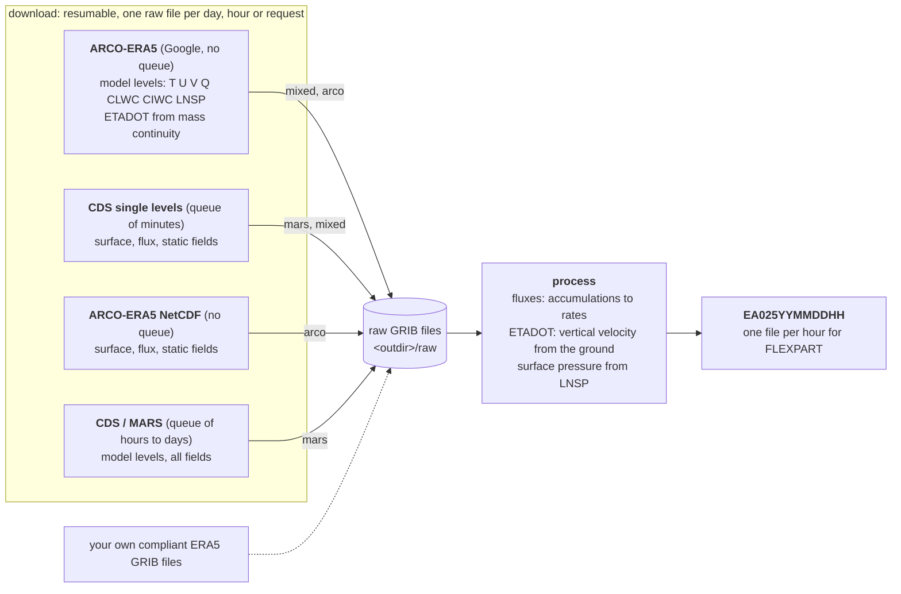
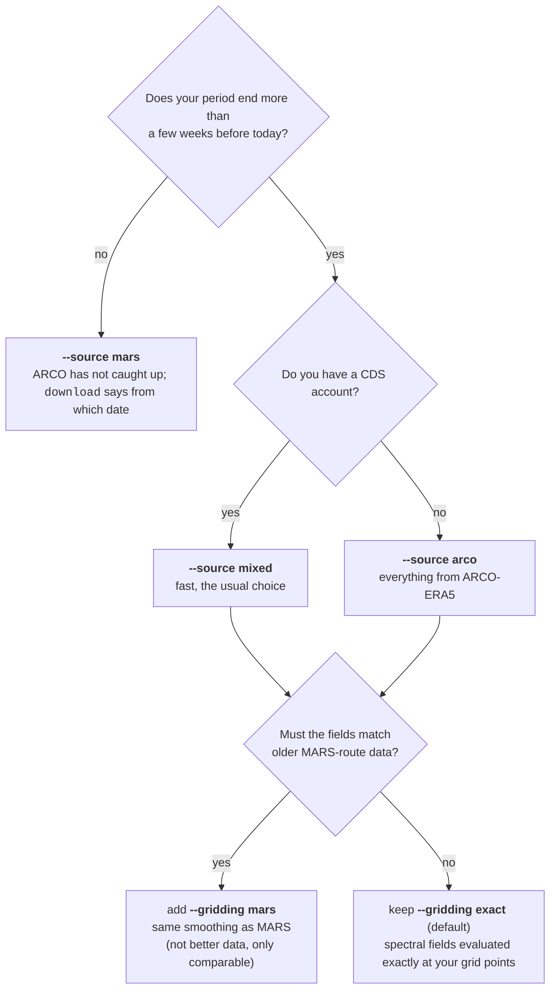
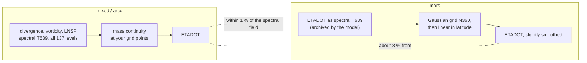

# dcFlexExtract

ERA5 → hourly FLEXPART input files, with the download **decoupled** from the post-processing.

## In short

```
A="--start 20230830 --end 20230902 --area 61 21 59 25 --levels 60 137 --source mixed --outdir /scratch/me/run1"

./dcfe.sh setup --no-fortran     # once: checks Python packages, installs only what is missing
./dcfe.sh download $A            # model levels from ARCO-ERA5 (no queue), surface and fluxes from CDS; safe to stop and restart
./dcfe.sh process  $A            # writes /scratch/me/run1/EA025YYMMDDHH, one file per hour, ready for FLEXPART
```

* **You choose** dates, area, grid and model levels. Everything else is fixed; only ERA5 is supported.
* **`download`** survives interruptions and never throws away what it has. **`process`** turns *any* directory of
  compliant ERA5 GRIB files (downloaded by `download` or by hand) into the hourly files.
* **`--source`** decides where the data comes from (see the first chart). `mixed` is the fast route and the one the
  examples use: the model levels come from Google's public ARCO-ERA5 without a queue. ARCO ends a few weeks before today; for
  later days `download` stops *before* sending anything and tells you to use `--source mars` from a given date.
  `arco` needs no CDS account at all. `mars` (everything from CDS/MARS) is what the program does if `--source` is left out.
* `./dcfe.sh --help` lists all options with their use, `./dcfe.sh <command> --help` shows one command.

### How the data flows



| `--source` | model levels | surface, flux, static | needs | speed |
|---|---|---|---|---|
| `mars` (program default) | CDS/MARS | CDS | CDS account | the MARS queue: hours to days |
| `mixed` | ARCO-ERA5 | CDS | CDS account, `numcodecs` | no queue for the model levels, CDS single levels in minutes |
| `arco` | ARCO-ERA5 | ARCO-ERA5 NetCDF | `numcodecs`, `netCDF4` | no queue, no account; reads about 0.75 GB per day plus 0.8 GB per hour |

### Which route?



### Where ETADOT comes from

ARCO-ERA5 does not hold the model's vertical velocity, so `mixed` and `arco` compute it from the mass continuity equation
with the divergence of **all 137 levels**. It agrees within 1 % (rms) with the model's own spectral ETADOT. MARS delivers the
same spectral field, but smooths it on its way to a 0.25° grid, which is why the two routes differ by about 8 % in ETADOT.



Details and checks: [*Exact or MARS gridding*](#exact-or-mars-gridding---gridding) and `docs/etadot/`.

<video src="docs/mars_server_persp.mp4" controls muted width="100%">
  Your viewer does not play embedded video:
  <a href="docs/mars_server_persp.mp4">watch docs/mars_server_persp.mp4</a>.
</video>

*The MARS server procedure (video, [direct link](docs/mars_server_persp.mp4)).*

## Options

**Domain options** (`plan`, `download`, `process`; use the same values for all three):

| option | meaning |
|---|---|
| `--start YYYYMMDD` / `--end YYYYMMDD` | first and last day, inclusive; how they are chunked for CDS is not your concern |
| `--area N W S E` | latitude/longitude rectangle, degrees |
| `--grid` | `0.25` (default) or `0.5` |
| `--levels FIRST LAST` | model levels, default `60 137` (137 is the lowest level, at the surface). All levels of a run go into one request |
| `--source` | `mars` (default, everything from CDS/MARS), `mixed` (model levels from ARCO-ERA5, no queue, the rest from CDS) or `arco` (everything from ARCO-ERA5, no CDS account); see *Model levels from ARCO-ERA5* below |
| `--arco-cache DIR` | for `download` with `--source mixed` or `arco`: keep the global ARCO data in DIR and reuse it for any area (`plan` and `process` ignore it); see *Keeping the global data* below |
| `--gridding` | with `--source mixed` or `arco`: `exact` (default) or `mars`, how the spectral fields are put on the grid; see *Exact or MARS gridding* below |
| `--pressure` | surface pressure source: `lnsp` (default), `sp`, `spectral`; see *Surface pressure* below |
| `--outdir DIR` | where everything of the run goes (default `out`): hourly files, raw data in `DIR/raw`, logs in `DIR/logs` |
| `--rawdir DIR` | raw GRIB files (default `<outdir>/raw`); `process` searches it recursively |

**`download`:**

| option | meaning |
|---|---|
| `--once` | one step (collect finished jobs, submit new ones), then exit; for cron or short jobs. Without it the program loops until everything is done |
| `--poll SECONDS` | wait when nothing changed, and the shortest time between two status checks of the same queued CDS job (default 60). A refused request is split and its parts are submitted at once, without waiting, so a short `--poll` is not needed to speed that up (and a very short one means many status calls to CDS) |
| `--inflight-mars N` | open MARS jobs, i.e. model levels (default 2); MARS runs one request per user at a time, the others wait |
| `--inflight-sfc N` | open single-levels jobs (default 3) |
| `--split-order LIST` | how a request that CDS refuses is made smaller, first to last: any of `days`, `variables`, `area`, `levels`, `hours` (default in that order); kinds left out are never used. See *What the downloader does* |
| `--spans ML=30,SL=31` | days per request to try first, by group (`ML LNSP SL SP FLUX`); default: the whole period (single-level groups: one calendar month). Normally not needed |

**`process`:**

| option | meaning |
|---|---|
| `--check` | only report what is missing for each hour; writes nothing |
| `--remove-raw` | when every hour is written, delete the raw files the run used and the download manifest; see *Removing raw files* |
| `--etadot-boundary ground\|top` | vertical velocity integrated from the ground (default) or, as flex_extract did, from the top of the retrieved levels; see *Vertical velocity* |
| `--exe PATH` | the `calc_etadot` executable (only for `--pressure spectral`) |
| `--scratch DIR`, `--keep-scratch` | per-hour working files (default `<outdir>/.scratch`); keep them after the run |

#### Removing raw files

`process` keeps the raw files, so it can be re-run with other options. `process --remove-raw` deletes them after the
last hourly file has been written, never earlier and never if any hour is missing. It removes only raw files that were
used and whose data all lie within the period plus one day either side (the flux padding), so a file that also holds other days is kept
(and reported). Empty directories and the finished `manifest.json` go too, so a later `download` starts afresh. It cannot be undone.
Output files are not touched.

**`plan`** also takes `--show-request` (print the CDS request bodies) and `--spans`. **`cleanup`** takes `--outdir` and
`--yes` (really delete finished CDS jobs; without it only the number is shown). **`setup`** takes `--no-fortran`.

## Origin and licence

dcFlexExtract builds on **flex_extract** by **Anne Philipp, Leopold Haimberger and Petra Seibert**
(https://www.flexpart.eu/wiki/FpInputMetEcmwf): the processing chain, the Fortran program `calc_etadot` and the
flux disaggregation come from their work, and we are grateful for it. Please cite Tipka, Haimberger and Seibert,
Geosci. Model Dev. 13, 5277-5310, 2020 (https://doi.org/10.5194/gmd-13-5277-2020) when you use this software,
and Hittmeir, Philipp and Seibert, GMD 11, 2503-2523, 2018 for the flux disaggregation. `NOTICE.md` lists
exactly what was taken, what was changed, and the third-party material.

Licence: **CC BY 4.0**, as for flex_extract (`LICENSE`); `fortran/Makefile` is GPL-2.0-only
(`LICENSES/GPL-2.0-only.txt`) because it is adapted from a flex_extract makefile under that licence.

## Install

Modules first: `dcfe.sh` installs nothing if the environment already provides what it needs.

```
./dcfe.sh setup               # checks Python, ecCodes, numpy, CDS client; installs only what is missing; builds + tests calc_etadot
./dcfe.sh setup --no-fortran  # same, without the Fortran step (then --pressure spectral is not available)
./dcfe.sh selftest            # re-run just the calc_etadot check (compares fort.15 byte for byte)
```

Needs: Python 3 with `numpy`, the ecCodes Python binding (`eccodes`), `ecmwf-datastores-client`, `numcodecs` (`--source mixed`, `arco`) and `netCDF4` (`--source arco`). Anything the
loaded modules do not provide is pip-installed into a `.venv` that still sees the module packages
(`--system-site-packages`). A working `~/.cdsapirc` (`url:` and `key:` lines) is read for CDS access.

The Fortran program `calc_etadot` is only used with `--pressure spectral` (and is built by `setup`). It needs
gfortran, make and ecCodes with its Fortran interface (pkg-config `eccodes_f90`, or `ECCODES_DIR`). EMOS is **not**
needed (`fortran/fft99_lite.f90` replaces it).

**Modules per site** are in `sites/<site>.sh` (`DCFE_SITE=csc|local` forces one). On **CSC (Roihu)**: `python-geo` and
`eccodes` are always loaded; `gcc` only for `setup`, `build`, `selftest` and `--pressure spectral`. Setup and the
default download have been run on Roihu; the spectral route is still being tested there. If linking ecCodes' Fortran interface needs more modules (e.g. openmpi, netcdf-fortran), add them to
`site_modules_fortran` in `sites/csc.sh`.

## Use

```
A="--start 20230830 --end 20230902 --area 61 21 59 25 --grid 0.25 --levels 60 137 --source mixed --outdir /scratch/me/era5_run1"

./dcfe.sh plan     $A            # what would be requested (units, expected message counts)
./dcfe.sh download $A            # loop until everything is downloaded; safe to stop (Ctrl-C) and restart
./dcfe.sh process  $A --check    # what is still missing for each hour
./dcfe.sh process  $A            # writes <outdir>/EA025YYMMDDHH
```

Run `download` in `tmux`/`screen` on a login node or laptop: CDS queues can take days and a Slurm job
cannot cover them. The loop only sleeps and polls. `--once` does everything that can be done now (including the whole split ladder after a refusal) and exits (cron or a short
job). Use the same `--outdir` for `download` and `process`: raw data is kept in `<outdir>/raw` (override with
`--rawdir`), the hourly files go to `<outdir>`. On HPC point `--outdir` to scratch.

### Running the download from cron (`--once`)

Instead of a long-running loop, `download --once` does one pass and exits: it fetches the jobs that have
finished, deletes them at CDS, submits new pending units (up to the per-queue limits) and prints a summary
such as `{'done': 5, 'submitted': 2}`. Repeat it until everything is `done`. Use identical options every time.
A lock on the manifest stops a second copy from starting while one is still working.

```
# crontab -e   (every 30 minutes; use absolute paths, cron has no login environment)
*/30 * * * * cd /home/me/dcFlexExtract && ./dcfe.sh download --once --start 20230830 --end 20230902 --area 61 21 59 25 --grid 0.25 --levels 60 137 --source mixed --outdir /scratch/me/era5_run1 >> /scratch/me/era5_run1_cron.out 2>&1
```

* The exit status is 0 even if some units failed; look for `FAILED` in `<outdir>/logs/` or run
  `./dcfe.sh download --once ...` by hand and read the summary line.
* A run can take a while when large files are fetched; cron will not start a second copy meanwhile
  (the manifest lock refuses it, and that attempt exits).
* Remove the cron line when the summary shows only `done`, then run `process`.
* Whether cron is allowed depends on the machine; on CSC login nodes use `tmux` and the normal loop mode
  instead. The `--once` mode is also suitable for a short Slurm job, but not for waiting out a CDS queue.

### Logs

Every `download`, `process` and `cleanup` run writes a log in `<outdir>/logs/`:

* `YYYYmmdd-HHMMSS_<command>.log` – one file per run, with timestamps. It starts with two comment lines: the
  date, weekday and time, and the full command (`# bash ./dcfe.sh download ...`, ready to copy). Then the exact command line
  used (as typed to `dcfe.sh`), working directory, host, Python/ecCodes/CDS-client versions and all arguments.
  Then: every request sent to CDS (full body) and its job id, job state changes, retries/splits/errors, every
  file saved (path, bytes, message count) and CDS job deleted; for `process` the raw files indexed, which raw
  files each hour was built from, the `calc_etadot` namelist, command and result, and every output file
  (path, bytes, message count). The console shows only the short INFO lines.
* `commands.log` – one comment line per invocation (`# date weekday time [command] bash ./dcfe.sh ...`), appended across runs.

`plan` writes nothing. The CDS key is never logged.

### What the downloader does

* One unit = a few days × one group (model levels, LNSP, surface, fluxes, static). Files are named after
  their content, so a restart re-uses finished files and re-attaches to jobs still queued at CDS (job ids
  are kept in `raw/<domain>/manifest.json`). A file is only accepted if its GRIB message count is right.
* **Always the largest request first.** The whole period goes into one MARS request (single-level requests: one
  per calendar month the run touches, containing only the days of that month), all chosen levels, the whole area.
  Only if CDS refuses it is it split, in this order: days (halving, down to single days) → variables (one is dropped
  at a time until the request is accepted; the dropped variables of the same request are asked for together, and
  peeled the same way if that is refused too) → area (halving, three times, i.e. down to 1/8 of the domain) →
  model levels (halving) → hours → still smaller tiles. A refusal comes back immediately and costs no queue
  wait; only accepted requests wait. The largest accepted number of days per group is learned and reused. Day, variable,
  level and hour parts are plain GRIB and are simply concatenated by `process`.
  **Tiles are not**: they are sub-areas of the same fields and must be mosaicked to the full grid, which `process`
  cannot do yet; it stops with a clear message if it finds tiled data.
  `download --split-order days,variables,levels,hours` sets the order yourself: kinds you leave out are never
  used (leave out `area` and no file is ever a tile; a request that is still refused then fails with a clear
  message). Valid kinds: `days`, `variables`, `area`, `levels`, `hours`; default `days,variables,area,levels,hours`.
* Queues: MARS (`reanalysis-era5-complete`: model levels, LNSP) allows one running request per user, so
  `--inflight-mars` defaults to 2; single-level data is not MARS and runs `--inflight-sfc` (3) jobs in
  parallel. Each finished CDS job is deleted after a verified download. `./dcfe.sh cleanup` lists
  successful jobs still stored in your account, `cleanup --yes` deletes them.

### Your own data

Put GRIB files anywhere under `--rawdir`; `process` indexes them by content (not by file name) and
reports missing fields. Required per hour: T U V Q ETADOT CLWC CIWC on all chosen levels, spectral LNSP,
the 9 surface fields (SD MSL TCC 10U 10V 2T 2D Z LSM), 6 fluxes (LSP CP SSHF EWSS NSSS SSR, accumulated, from
the 06/18 forecasts incl. the day before/after) and the 4 static fields (SDOR CVL CVH FSR).

### Adding upper levels later

Each run requests its levels as **one** model-level request (MARS waits are per request, so fewer, larger requests
are faster; levels are never split). To add levels to data you already have, download only the new ones into the
same raw directory, e.g. after `--levels 60 137`: `download ... --levels 1 59 --rawdir <same>` (with
`--pressure spectral`/`sp` this also repeats the pressure request; with `lnsp` it carries gridded LNSP again,
harmless). `process` finds data by content, so `process ... --levels 1 137` then uses both pieces. Write the result
to a **new** `--outdir`: existing output files are skipped, not overwritten.

## Output

`EA025YYMMDDHH` (prefix `EA` + grid×100) holds, per hour: U V ETADOT T SP Q on all levels, CLWC, CIWC,
6 fluxes (disaggregated to instantaneous rates), 9 surface fields, 4 static fields; mixed GRIB1/GRIB2
as delivered by CDS (FLEXPART v11 reads GRIB1, GRIB2 and mixed). Checked against an old flex_extract hourly file (566 messages) with `--etadot-boundary top`:
identical layout and surface fields; model-level fields differ by at most 2.5e-4 of a field's maximum (ETADOT
near the surface), others far less.

### Precipitation units and GRIB editions (warning)

The convective (CP) and large-scale (LSP) precipitation fields leave dcfe in the same unit (mm/h) and as GRIB1
messages, as in the files of the original flex_extract. FLEXPART treats the two fields differently when they are
GRIB2: its GRIB2 reader divides CP (and snow depth) by 1000 but not LSP (`conversion_factor` in
`windfields_mod.f90`, still so in the FLEXPART master of November 2026). The GRIB1 reader uses 1 for both. We
checked this by rewriting the CP messages of the same files as GRIB2 (values unchanged): FLEXPART then reads a
maximum CP of 3.8e-4 instead of 3.8e-1 mm/h, while LSP is unchanged.

dcfe's output is therefore correct for FLEXPART only because the flux fields are GRIB1. FLEXPART relies on the
ECMWF data keeping the grib editions it has today (flux fields in GRIB1, model levels in GRIB2), and that is not
something anyone can promise: ECMWF has been moving its products to GRIB2 for years. If you change the flux fields
to GRIB2, or if a future version of this software or of the data source delivers them so, CP will be 1000 times too
small in FLEXPART, which makes wet deposition and scavenging by convective rain far too weak, with no error message.
Keep the flux messages GRIB1, or fix or ask about the factor in FLEXPART first (draft question in
`docs/flexpart-cp-grib2-question.md`).

### Surface pressure (`--pressure`)

FLEXPART takes the pressure of every model level from the surface pressure SP (A and B coefficients), so SP
matters. Three sources:

| `--pressure` | SP comes from | MARS requests | Fortran |
|---|---|---|---|
| `lnsp` (default) | exp(LNSP) of ERA5 model level 1, on the same grid as the other fields | none: LNSP goes in the model-level request | not used |
| `sp` | ECMWF's single-levels `surface_pressure` | none (single-levels queue, parallel) | not used |
| `spectral` | spectral LNSP through `calc_etadot` (flex_extract's way) | one more (spectral LNSP, separate request) | `calc_etadot` |

They are not identical: on the 2023-08-30 14 UTC test box exp(gridded LNSP) differs from the spectral SP by 20 Pa
rms (max 52 Pa) and ECMWF's SP by 29 Pa rms (max 102 Pa); the effect on model-level heights is under 4 m (`lnsp`)
or 8 m (`sp`) at level 60 and nil near the ground (`livetest/pressure_analysis.py`). With `lnsp` and `sp`
`process` needs no Fortran build; ETADOT is converted by `dcfe/etadot.py` in all three. Use a new `--outdir` when
you change source, and the same `--pressure` for `download` and `process`.

With `lnsp` the model-level request also carries level 1, because LNSP lives there; the other variables come back
on level 1 too (about 1/79 more data, ignored by `process`). CDS answers HTTP 500 to a level list that mixes a lone
level with a range (`1/60/to/137`), so the levels are written out (`1/60/61/.../137`).

### Model levels from ARCO-ERA5 (`--source mixed`)

`--source mars` (default) fetches everything from CDS. The model levels are the slow part (the MARS queue waits hours to
days), so `--source mixed` takes them from **ARCO-ERA5**, Google's public copy of ERA5 (`gs://gcp-public-data-arco-era5`,
read over plain HTTPS: no account, no queue). Surface, flux and static fields still come from CDS (the single-levels
queue, which is quick), so a run needs a CDS account either way. The model-level part of `download` becomes local
work: for each hour it reads the global spectral T639 fields and evaluates them on your box.

| field | from ARCO | note |
|---|---|---|
| T, U, V | spectral `t`, vorticity, divergence | U, V through stream function and velocity potential; exact derivatives |
| LNSP, SP | spectral `lnsp` | exp(LNSP) on the box (as `--pressure lnsp`); `--pressure` must stay `lnsp` |
| Q, CLWC, CIWC | N320 reduced Gaussian grid | bilinear interpolation to your grid |
| ETADOT | not in ARCO: mass continuity | from the divergence of **all 137 levels** and the surface-pressure gradient, no time derivative |

The result is written as one GRIB file per hour, `<rawdir>/<domain>/<day>/ARCO_ML_L060-137_hHH.grb`, in the same form
as the MARS data, so `process` is unchanged. `download` is resumable per hour. Data volume read per hour is about
0.8 GB (every chunk is one level of one variable, 1.2-1.6 MB, global), CPU is a minute or so per hour on a large domain.

What to know before using it:

* **The numbers differ somewhat from the MARS route, and the ARCO values are the exact ones.** MARS does not hand over the
  spectral field exactly at your grid points; it smooths it a little (see *Exact or MARS gridding*). The effect is
  0.01% in T, below 1% in U and V (near the ground up to 3%), about 8% (rms, levels 60-137) in ETADOT and 20 Pa rms in SP.
  Q, CLWC and CIWC are interpolated from the N320 grid. The ETADOT computed here from the continuity equation is within 1%
  of the model's own spectral ETADOT. FLEXPART has not been run on either route.
* **Dates.** ARCO ends a few weeks before today (all three of its wind, moisture and surface-pressure stores are needed;
  the earliest end counts) and the final-ERA5 stores end months earlier; days after that are preliminary ERA5T. If a day
  of the run is missing, `download` stops before sending anything and tells you from which date to use `--source mars`.
  A run cannot mix the two sources.
* **ETADOT and levels.** As with MARS data, the ground boundary needs levels that end at 137.
* Needs `numcodecs` (part of any zarr installation) and, for `--source arco`, `netCDF4`; `setup` installs what the modules lack. Data: Copernicus
  Climate Change Service (ERA5), via Google's ARCO-ERA5; see `NOTICE.md` for the licence and the citation.
* Use a new `--outdir` when you change `--source`.

### Everything from ARCO-ERA5 (`--source arco`)

`--source arco` takes the model levels as `mixed` does and also the surface, flux and static fields from ARCO-ERA5, so
**no CDS account and no request is needed**. These fields are in the bucket as hourly global NetCDF files (one per
variable and day, about 50 MB; `raw/date-variable-single_level`). For each day `download` fetches the files one task at a
time (flux day: 6 files, surface day: 9, static: 4 once), cuts the box, writes GRIB1 messages in the form of the MARS route
(`ARCO_SL_<day>.grb`, `ARCO_FLUX_<day>.grb`, `ARCO_STATIC.grb`) and deletes the NetCDF files, so `process` is unchanged.
It reads about 0.75 GB per day before the model levels (0.8 GB per hour), and needs `netCDF4`.

* The fields are the CDS hourly ERA5 fields. Against the MARS route the NetCDF values are packed in 16 bit by CDS, so
  surface and flux fields differ by up to about 4·10⁻⁴ of the field maximum (precipitation by 0.0003 mm per hour as an
  absolute value); the flux accumulations are the hourly accumulations ending at the labelled hour, as in the MARS data.
* Fluxes need one day before and one after the run, as with CDS. `download` stops at once if the first or last file is
  not in the bucket yet (ARCO ends a few weeks before today).
* `--pressure` must stay `lnsp`. Use a new `--outdir` when you change `--source`.

`livetest/arco_nc_check.py` compares the result with MARS-route raw data.

### Keeping the global data (`--arco-cache`)

ARCO-ERA5 can only be read as global data: one chunk per variable, model level and hour, and one NetCDF file per
single-level variable and day. Normally dcfe cuts your area from it and throws the rest away. With
`download --arco-cache DIR` it also keeps what it downloaded, and reads from `DIR` whenever the data is there. A later
run for **another area**, grid or `--gridding`, by you or a colleague using the same directory, then downloads only what
is missing (more hours, or more levels).

```bash
./dcfe.sh download $A --source arco --arco-cache /shared/era5-arco --outdir /scratch/me/run1
```

* **Size.** With levels 60-137 plan for **15-20 GB per day** (about 500 GB per month, 6 TB per year): one tested hour
  took 0.61 GB, and the surface and flux files add about 0.75 GB per day. Nothing is ever deleted automatically.
  A run also needs the flux files of one day before and after its period.
* **Speed.** The cache saves the download only. Evaluating the spectral fields on your area is done again in every run
  (on a small test area one hour took 31 s from the cache and 55 s with download; the surface files 0 s and 29 s).
* **`--source arco` gains most.** With `mixed` only the model levels are cached; the surface, flux and static fields
  are requested from CDS for your area, queue included.
* **Network.** Still needed: dcfe reads the stores' small metadata files to see which dates exist.
* **Only final ERA5 is kept.** Preliminary ERA5T (the latest months) may still be revised and is downloaded every time.
* **Already built hours are skipped**, so rerunning in a finished `--outdir` adds nothing to the cache.
* **Sharing.** Several runs can use one cache at the same time. For a group, give the directory the group and the setgid
  bit (`chgrp mygroup DIR; chmod g+rwxs DIR`) and run with `umask 002`. Someone who can only read it still benefits;
  the run warns once that it cannot add to it. Everyone who can write to the directory is trusted: the files are used
  as they are (only unreadable ones are downloaded again).
* The files lie under the same paths as in the bucket. Delete old ones whenever you need the space, but not while a run
  is using the cache.

### Exact or MARS gridding (`--gridding`)

ERA5's model-level fields are spectral (T639). For a lat-lon grid MARS first synthesises the full field on a regular
Gaussian grid (N360 for 0.25 degrees, whose longitudes coincide with the lat-lon grid) and then interpolates **linearly
in latitude** to your latitudes (the MARS defaults: `truncation=AUTO`, `intgrid=AUTO`, `interpolation=linear`). Linear
interpolation between rows damps the shortest waves. T, U, V hardly notice, but ETADOT and divergence carry 3-38% of
their variance at wavenumbers above 320, which is why MARS's 0.25 degree ETADOT differs by about 8% from the exact field.

* `--gridding exact` (default): the spectral sums are evaluated exactly at your grid points. This is closest to the
  model's own field.
* `--gridding mars`: repeats MARS's steps (Gaussian rows around your box, linear interpolation in latitude). U, V, T
  then agree with MARS-route data to numerical precision and ETADOT to about 1% (the difference to the model's own ETADOT
  of the continuity calculation). **Use it only when you need consistency with data made by the MARS route, for instance
  to continue an older series. It is not better data, only comparable data.** It costs a few more rows per run.

`livetest/gridding_check.py` compares both with a MARS raw file.

### Vertical velocity (ETADOT) and the integration boundary

ERA5 gives `eta_dot` on full levels; FLEXPART needs `eta_dot * dp/deta` on half levels, which `calc_etadot`
obtains with a running sum over the levels. That sum needs a starting value. flex_extract starts at the top of
the **retrieved** levels with 0, which is only right when level 1 is included. For e.g. levels 60-137 the true
value there is not zero (about 0.04 Pa/s in a test over southern Finland), and the error appears with
alternating sign in every level and leaves a non-zero vertical velocity at the ground. dcFlexExtract therefore
integrates upward from the ground, where the value is exactly zero, which is correct for any level range ending
at the lowest level (checked against mass continuity: `livetest/etadot_continuity_test.py`).

* `--etadot-boundary ground` (default): the corrected ETADOT. The Fortran step still runs; before its ETADOT is
  replaced, our own implementation of its calculation must reproduce it (otherwise the run stops).
* `--etadot-boundary top`: flex_extract's behaviour, for reproducing earlier output.

Output files that already exist are skipped, so use a new `--outdir` when you switch the boundary. If the levels
do not end at the lowest model level the ground boundary cannot be used and a warning is logged.

## Checklist: first run on CSC (Roihu)

Setup and the default (`lnsp`) download have been run on Roihu and work; the spectral route and the later steps are
still being tested. Go in this order; stop at the first failing step and note the exact message.

1. **Get the code** and enter it: `git clone https://github.com/pclusius/dcFlexExtract && cd dcFlexExtract`.
2. **CDS key:** `~/.cdsapirc` has the `url:` and `key:` lines (`chmod 600`).
3. **Environment:** `./dcfe.sh setup`. Check in the printed list that `eccodes`, `numpy` and `ecmwf.datastores` are
   *found*. If one is `NOT found`, only that package is pip-installed into `.venv`; note which one it was. Then
   `calc_etadot works` must appear. If the Fortran link fails, read the error: add the module it asks for
   (e.g. openmpi, netcdf-fortran) to `site_modules_fortran` in `sites/csc.sh`. Without Fortran use `setup --no-fortran`.
4. **Tests:** `python -m pytest -q tests` (needs pytest; no network). Expect all to pass.
5. **Plan, no network:** `./dcfe.sh plan --start 20230830 --end 20230830 --area 61 21 59 25 --levels 60 137`
   prints 4 units, one of them `ML_all-LNSP_L060-137` (the only MARS request).
6. **Small download** in `tmux` on a login node, outdir on scratch:
   `./dcfe.sh download --start 20230830 --end 20230830 --area 61 21 59 25 --levels 60 137 --outdir /scratch/<project>/dcfe_test`.
   The model-level request waits in the MARS queue (hours). Interrupt with Ctrl-C and run the same command again
   to check that it re-attaches. Look at `<outdir>/logs/`.
7. **Process the default route** (no Fortran): same options plus `process`. Expect 24 files `EA02523083000`..`23`
   with 566 messages each (`grib_count`), and a log that says `ETADOT boundary: ground  pressure: lnsp`.
8. **Other routes:** `--pressure sp` (needs its own single-levels download) and `--pressure spectral` (needs the
   spectral LNSP download and `calc_etadot`; note the seconds per hour from the log, and the grid size).
9. **Cron, optional:** `download --once` from cron on a login node, if the site allows it (see above).
10. **Report back:** versions printed by `setup`, module list (`module list`), timings, anything that needed
    changing in `sites/csc.sh`.

## Tests

`./.venv/bin/python -m pytest tests` (no network needed; CDS is replaced by a fake client).
`tests/test_fft99_lite.sh` compares the EMOS-free FFT with EMOS if EMOS is installed.

## Layout

```
dcfe/         config, request builder, downloader (+manifest), GRIB index, flux disaggregation, process
fortran/      calc_etadot sources, Makefile, selftest/ (installation test data)
sites/        csc.sh, local.sh (module loads)
NOTICE.md     origin, authors, modifications, third-party material; LICENSE, LICENSES/ the licence texts
docs/         baseline.md (what the old flex_extract requests and produces)
dcfe.sh       launcher
```
